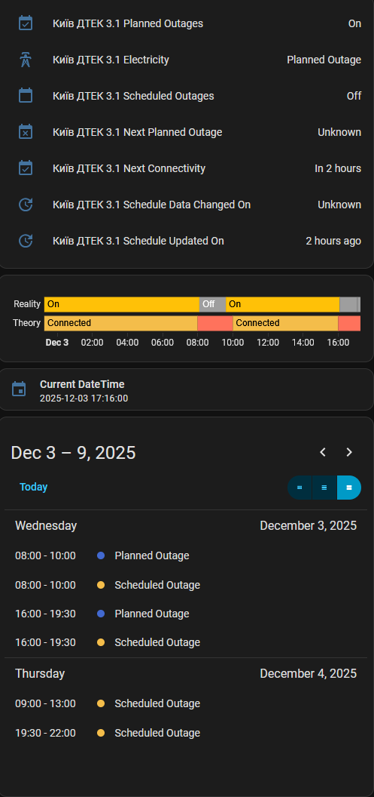

[](https://stand-with-ukraine.pp.ua)
[](https://stand-with-ukraine.pp.ua)
[](https://stand-with-ukraine.pp.ua)
[](https://stand-with-ukraine.pp.ua)

[![GitHub Release][gh-release-image]][gh-release-url]
[![hacs][hacs-image]][hacs-url]


# 💡 Svitlo Yeah | Світло Є

A [Home Assistant][home-assistant] integration that tracks electricity outage schedules from Ukrainian energy providers,
providing outage calendars, countdown timers, and status updates.

###### [Цей документ українською](https://github-com.translate.goog/ALERTua/ha-svitlo-yeah/blob/main/README.md?_x_tr_sl=en&_x_tr_tl=uk&_x_tr_hl=en&_x_tr_pto=wapp)

## Supported Regions

| Region                         | Provider | Data Source                                                                                                                                                                                                                             |
|--------------------------------|----------|-----------------------------------------------------------------------------------------------------------------------------------------------------------------------------------------------------------------------------------------|
| **Kyiv**                       | DTEK     | [Yasno API](https://yasno.ua)                                                                                                                                                                                                           |
| **Dnipro**                     | DnEM     | [Yasno API](https://yasno.ua)                                                                                                                                                                                                           |
| **Dnipro**                     | CEK      | [Yasno API](https://yasno.ua)                                                                                                                                                                                                           |
| **Kyiv Oblast**                | DTEK     | [Baskerville42/outage-data-ua](https://github.com/Baskerville42/outage-data-ua/blob/main/data/kyiv-region.json)                                                                                                                         |
| **Dnipro and Oblast**          | DTEK     | [Baskerville42/outage-data-ua](https://github.com/Baskerville42/outage-data-ua/blob/main/data/dnipro.json)                                                                                                                              |
| **Odesa and Oblast**           | DTEK     | [Baskerville42/outage-data-ua](https://github.com/Baskerville42/outage-data-ua/blob/main/data/odesa.json)                                                                                                                               |
| **Khmelnytskyi and Oblast**    | KhOE     | [yaroslav2901/OE_OUTAGE_DATA](https://github.com/yaroslav2901/OE_OUTAGE_DATA/blob/main/data/Khmelnytskoblenerho.json)                                                                                                                   |
| **Ivano-Frankivsk and Oblast** | POE      | [yaroslav2901/OE_OUTAGE_DATA](https://github.com/yaroslav2901/OE_OUTAGE_DATA/blob/main/data/Prykarpattiaoblenerho.json)                                                                                                                 |
| **Uzhhorod and Oblast**        | ZOE      | [yaroslav2901/OE_OUTAGE_DATA](https://github.com/yaroslav2901/OE_OUTAGE_DATA/blob/main/data/Zakarpattiaoblenerho.json)                                                                                                                  |
| **Lviv and Oblast**            | LOE      | [yaroslav2901/OE_OUTAGE_DATA](https://github.com/yaroslav2901/OE_OUTAGE_DATA/blob/main/data/Lvivoblenerho.json)                                                                                                                         |
| **Ternopil and Oblast**        | TOE      | [yaroslav2901/OE_OUTAGE_DATA](https://github.com/yaroslav2901/OE_OUTAGE_DATA/blob/main/data/Ternopiloblenerho.json)                                                                                                                     |
| **Chernihiv and Oblast**       | ChOE     | [yaroslav2901/OE_OUTAGE_DATA](https://github.com/yaroslav2901/OE_OUTAGE_DATA/blob/main/data/Chernihivoblenergo.json)                                                                                                                    |
| **Zaporizhzhia and Oblast**    | ZOE      | [yaroslav2901/OE_OUTAGE_DATA](https://github.com/yaroslav2901/OE_OUTAGE_DATA/blob/main/data/Zaporizhzhiaoblenergo.json)                                                                                                                 |
| **Zhytomyr and Oblast**        | ZhOE     | [yaroslav2901/OE_OUTAGE_DATA](https://github.com/yaroslav2901/OE_OUTAGE_DATA/blob/main/data/Zhytomyroblenergo.json)                                                                                                                     |
| **Poltava and Oblast**         | POE      | [yaroslav2901/OE_OUTAGE_DATA](https://github.com/yaroslav2901/OE_OUTAGE_DATA/blob/main/data/Poltavaoblenergo.json)                                                                                                                      |
| **Rivne and Oblast**           | ROE      | [yaroslav2901/OE_OUTAGE_DATA](https://github.com/yaroslav2901/OE_OUTAGE_DATA/blob/main/data/Rivneoblenergo.json)                                                                                                                        |
| **Vinnytsia and Oblast**       | VOE      | [olnet93/gpv-voe-vinnytsia](https://github.com/olnet93/gpv-voe-vinnytsia/blob/main/data/Vinnytsiaoblenerho.json)<br/>[vn-progr/gpv-voe-vinnytsia](https://github.com/vn-progr/gpv-voe-vinnytsia/blob/main/data/Vinnytsiaoblenerho.json) |
| **Sumy and Oblast**            | SOE      | [E-Svitlo API](https://sm.e-svitlo.com.ua/)                                                                                                                                                                                             |
| **Sumy and Oblast**            | SOE      | [soe.com.ua](https://www.soe.com.ua/consumers/shutdowns?tab=hourly-schedules)                                                                                                                                                           |

## Installation

The integration needs Home Assistant 2026.9.0 or later.

The quickest way to install this integration is via [HACS][hacs-url] by clicking the button below:

[![Add to HACS via My Home Assistant][hacs-install-image]][hasc-install-url]

If it doesn't work, adding this repository to HACS manually by adding this URL:

1. Visit **HACS** → **Integrations** → **...** (in the top right) → **Custom repositories**
2. Click **Add**
3. Paste `https://github.com/ALERTua/ha-svitlo-yeah` into the **URL** field
4. Choose **Integration** as a **Category**
5. **Svitlo Yeah | Світло Є** will appear in the list of available integrations. Install it normally.

## Usage

This integration is configurable via UI. On **Devices and Services** page, click **Add Integration** and search for **Svitlo Yeah**.

### Setup parameters

Before you start, find your outage group on the website of your provider. A Yasno provider (Kyiv or Dnipro) can find the group for you: you give the address of your house, and the integration asks Yasno for the group. See [Yasno address](#yasno-address). Sumy and Oblast has two options. «SOE — Sumy and Oblast — SOE» needs no login: find your sub-queue by address on [the site of Sumyoblenergo](https://www.soe.com.ua/consumers/shutdowns?tab=hourly-schedules). «E-Svitlo — Sumy and Oblast — SOE» needs the login and the password of your E-Svitlo personal cabinet instead, because E-Svitlo gives the group of your personal account. See [Sumy and Oblast (soe.com.ua)](#sumy-and-oblast-soecomua).

| Step | Field | Description |
|---|---|---|
| Select Region/System Distribution | Select your region/system distribution | The region or the distribution system operator that supplies electricity to your address. The list has each region of [Supported Regions](#supported-regions). |
| Outdated schedule data | I understand and accept the risk | Shows only when no DTEK JSON source of the region has fresh data. Select it to pick your group from the outdated schedule. See [Outdated schedule data](#outdated-schedule-data-dtek-json). |
| How to find your schedule | By address, By group | Shows for a Yasno provider. Select **By address** to give your address, and the integration finds the group. Select **By group** to select the group yourself. See [Yasno address](#yasno-address). |
| Address | City | Shows only where Yasno lists cities, today Dnipro. The name of your city, or a part of it. |
| Address | Street | The name of your street, or a part of it, at least three letters. |
| Select your city, Select your street | City, Street | Shows when more than one name matches. The list has at most 20 names. Its last option is «My city is not in the list, search again» or «My street is not in the list, search again». |
| Select your house | House | A dropdown with a search box. It lists all houses of the street. Select your house, or type its number. The first option, «This is not my street, search again», goes back to the address form. |
| Settings | Select your group | Your outage group, for example `1.1`. Find it on the website of your provider, for example [Yasno](https://static.yasno.ua/kyiv/outages) or [DTEK](https://www.dtek-krem.com.ua/ua/shutdowns). For DTEK Dnipro, the list shows a CEK group with its number in the source, for example «ЦЕК 1.1 (1001.1)». |
| E-Svitlo Authentication | Username | The login of your [E-Svitlo personal cabinet](https://sm.e-svitlo.com.ua/). |
| E-Svitlo Authentication | Password | The password of your E-Svitlo personal cabinet. |
| Select Account | Account | The personal account (address) whose outage schedule the entry shows. For another address, add one more entry. |

Each region and group is a separate entry, and so is each Yasno address. To change the group of a DTEK or soe.com.ua entry later, open the menu of the entry and select **Reconfigure**. It shows the **Select your group** field again. Reconfigure does not change an E-Svitlo entry, because E-Svitlo gives the group of the personal account. For another personal account, delete the entry and add it again.

For a Yasno entry, **Reconfigure** shows the same menu as the setup. **By address** suggests the current street (and city), and then the current house, so a check of the same address takes two clicks. **By group** preselects the current group. A group entry can get an address, and an address entry can go back to a group. Then it loses the **Update group** button, and it keeps the **Group** sensor. A new address in the same group is saved. Reconfigure ends with «Nothing changed» only when the group and the address are the same.

The integration gives a new entry the name of its device in the language of your Home Assistant, for example «Київ ДТЕК 52.1». An entry with an address, and its device, get the address as the name, for example «вул. Хрещатик, 36». In a region with cities, the name starts with the city, for example «м. Дніпро, вул. Грушевського Михайла, 1». The entity IDs come from the address too, for example `sensor.vul_khreshchatik_36_electricity`, so a new group does not change them. The name of an E-Svitlo entry has no address, for example «Суми E-Svitlo», and the name of its device has none either, for example «Суми E-Svitlo 4.1». The device of an E-Svitlo entry from an earlier version gets this name at the next start of Home Assistant, but its entity IDs stay. The same happens to the English name of a DTEK Kyiv Oblast device: «Kyiv Region 1.1» becomes «Kyiv Oblast 1.1». To update the entity IDs, open the device and select **Recreate entity IDs**. Reconfigure puts the new group or the new address into a name that the integration gave, and keeps a name that you gave. An entry from an earlier version keeps the name «Svitlo Yeah | Світло Є» until you rename it or Reconfigure changes its group or address.

<details>
<summary>Screenshots of the setup</summary>


</details>

### Yasno address

For Kyiv and Dnipro, you can give the address of your house instead of the group. The integration asks Yasno for the group of the address, and it keeps the entry in this group. Yasno can move a house to another group. Then the integration finds the new group by itself (see [New Yasno group of an address](#new-yasno-group-of-an-address)).

To add an entry by address, select a Yasno provider, and then select **By address**:

1. Enter the street. Type at least three letters of its name, or a part of it. Where Yasno lists cities (today Dnipro), the form asks for the **City** first.
2. If Yasno finds one name only, or your text is exactly one name, the setup goes on. The kind of the place is not necessary: «Хрещатик» is «вул. Хрещатик».
3. If more than one name matches, select yours in the list. The list has at most 20 names, and the text above it names the address so far. If your name is not there, select «My street is not in the list, search again». For a city, the option says «My city is not in the list, search again».
4. Select your house in the dropdown, or type its number in the search box. The dropdown lists all houses of the street. If the list lacks the number that you type, the integration searches for it at Yasno. If the street is wrong, select «This is not my street, search again».
5. Read the dialog after the setup. It names the address that Yasno found, and its group.

A form shows an error, and keeps your text, in these cases:

- The street has fewer than three letters.
- Yasno does not know the city, the street or the house.
- Yasno knows no house on the street.
- Yasno does not answer.
- The schedule of Yasno does not list the group of the address yet.

The address form and the group form link the Yasno page of the region (Київ or Дніпро), where you can look for your address.

The entry keeps the names of the address as Yasno writes them, and the group. It does not keep the IDs of Yasno, because Yasno changes its IDs every few days. The integration searches the names again at each check. Add one entry for each address. An address entry and a group entry with the same group are two entries.

### New Yasno group of an address

Once a week, the integration asks Yasno for the group of the address of each address entry. The check runs inside the regular update, after the fetch of the schedule. A restart of Home Assistant starts no extra check, and a new address starts the weekly clock. A check has one of three results:

- **Found**: Yasno gives a group.
- **Not found**: Yasno does not know the address.
- **Unknown**: Yasno does not answer, or its answer is not sure. The next try is in one hour.

When a check finds a new group, the integration waits. A second check at least one hour later must find the same group. Then the entry gets the new group and reloads. The **Group** sensor shows the new group, and the integration does three more things:

- It writes one info line to the log.
- It creates the notification «New Yasno group», for example «The Yasno group of «вул. Хрещатик, 36» changed from 19.1 to 20.1. The entry now shows the schedule of the new group.» A Ukrainian Home Assistant shows the text in Ukrainian.
- It fires the `svitlo_yeah_group_changed` event (see [Events](#events)).

A later change replaces the notification of the entry. When you delete the entry, the notification goes away. The **Update group** button skips the wait of one hour: it checks the group at once, and it switches to a new group at once.

If Yasno does not find the address in two checks, with no **Found** result between them, the group stays. The log gets one warning, and **Settings** → **Repairs** shows «Yasno does not find the address of …». See [Troubleshooting](#troubleshooting). A **Not found** or **Unknown** result makes no entity unavailable, and it changes no schedule.

#### Push to your phone

The blueprint «Svitlo Yeah - New Yasno group of an address» pushes a new group to a phone with the official Home Assistant app. To import it, select the button:

[](https://my.home-assistant.io/redirect/blueprint_import/?blueprint_url=https%3A%2F%2Fgithub.com%2FALERTua%2Fha-svitlo-yeah%2Fblob%2Fmain%2Fblueprints%2Fautomation%2Fsvitlo_yeah%2Fyasno_group_changed.yaml)

To import it by hand, go to **Settings** → **Automations & scenes** → **Blueprints** → **Import Blueprint**, and paste this URL: `https://raw.githubusercontent.com/ALERTua/ha-svitlo-yeah/main/blueprints/automation/svitlo_yeah/yasno_group_changed.yaml`

The blueprint has these inputs:

| Input | Description |
|---|---|
| Device to notify (`notify_device`) | The phone that gets the push. It is a device of the `mobile_app` integration. |
| Entry (`entry`) | The entry to watch. This input is optional. If you leave it empty, the blueprint watches each entry. |
| Title (`title`) | The title of the push. The default is «Нова група Yasno». |
| Message (`message`) | The text of the push. The default is «Група Yasno для «{{ entry_title }}» змінилася з {{ old_group }} на {{ new_group }}.» The text can use `entry_title` (the name of the entry, which is its address), `old_group` and `new_group`. |

### Outdated schedule data (DTEK JSON)

When there are no outages for a while, DTEK JSON sources may stop publishing and all data becomes outdated. In that case setup shows a confirmation step: you can still pick your group from the last-known schedule after acknowledging the risk. The step shows when the source last updated the schedule, in Kyiv time. Once outages resume, double-check that your group hasn't changed.

The outdated data serves only the choice of the group, and the integration does not use it after setup. The integration keeps the last fresh schedule of each entry, also across a restart of Home Assistant. If a source becomes outdated or does not answer, the integration uses that schedule until the source publishes fresh data again, also when that schedule gets older. The **Schedule Updated On** sensor shows the update time of the schedule that the integration uses.

### Sumy and Oblast (soe.com.ua)

The option «SOE — Sumy and Oblast — SOE» reads the schedule that the site of Sumyoblenergo shows. The site gives the schedule of the current day only, so the calendar and the next-outage sensors show the outages of tomorrow after midnight. A sub-queue without outages has an empty list on the site, and the **Electricity** sensor shows normal for it. If the site stops listing your sub-queue, the sensor shows unknown, and **Settings** → **Repairs** shows a warning. The site has no emergency schedules (ГАВ), which use other queue numbers. When Sumyoblenergo applies them, the hourly schedule on the site and in the integration does not apply.

### E-Svitlo refuses the login

If E-Svitlo refuses the login of an entry, for example after you change the password, Home Assistant shows a notification on the **Devices & services** page. Open it, and enter the current login and password. The new login must have access to the personal account of the entry. Until then, the entities show the last schedule, and the integration tries the old login at each update. If E-Svitlo refuses the login only for a while, for example during maintenance, the next update that logs in brings the schedule back by itself, and the notification disappears.

### Here's how the devices look

<details>
<summary>The device page</summary>


</details>

<details>
<summary>The sensors</summary>

 

</details>

### Calendar View

Then you can add the integration to your dashboard and see the information about the next planned outages.
Integration also provides a calendar view of planned outages. You can add it to your dashboard as well
via [Calendar card][calendar-card].

<details>
<summary>The calendars</summary>


</details>

### Examples

- [Automation](/examples/automation.yaml)
- [Dashboard](/examples/dashboard.yaml)

<details>
<summary>The dashboard of the example</summary>



</details>

## Integration Entities

The integration creates the following entities in Home Assistant:

### Sensors

| Entity                                                                                   | Type             | Purpose                                                          | Description                                                                                                                                                                                                                                                                                                                                              |
|------------------------------------------------------------------------------------------|------------------|------------------------------------------------------------------|----------------------------------------------------------------------------------------------------------------------------------------------------------------------------------------------------------------------------------------------------------------------------------------------------------------------------------------------------------|
| **Electricity**                                                                          | Enum Sensor      | Shows current power connectivity state according to the calendar | Indicates the current electricity status with three possible states: `connected` (normal power), `planned_outage` (scheduled blackout), or `emergency` (unscheduled blackout). Shows `unknown` while the source has no schedule for the configured group. Shows `connected` while the integration has no DTEK schedule, for example for a new entry while the source has no fresh data, because the integration has no outage events then. Reflects the calendar state and shows if there is an ongoing outage event at the moment. Provides additional attributes including event details when an outage is active. |
| [**Schedule Updated On**](/custom_components/svitlo_yeah/translations/uk.json#L97)       | Timestamp Sensor | Shows when outage schedule was last updated by the provider      | Displays the timestamp when the energy provider last updated the outage schedule on their servers. Reflects server-side data changes, not client fetch times.                                                                                                                                                                                            |
| [**Schedule Data Changed On**](/custom_components/svitlo_yeah/translations/uk.json#L100) | Timestamp Sensor | Shows when actual outage schedule data changed                   | Tracks the timestamp when the actual data was modified. Useful for notifications when schedules are updated. See examples.                                                                                                                                                                                                                               |
| [**Next Planned Outage**](/custom_components/svitlo_yeah/translations/uk.json#L104)      | Timestamp Sensor | Shows the start time of the next planned outage                  | Displays the timestamp when the upcoming planned outage is planned to begin. Null when there are no planned outages.                                                                                                                                                                                                                                     |
| [**Next Scheduled Outage**](/custom_components/svitlo_yeah/translations/uk.json#L107)    | Timestamp Sensor | Shows the start time of the next scheduled outage                | Displays the timestamp of the upcoming scheduled outage event, comparing scheduled outages and planned outages to show whichever comes first. Null when no outages are scheduled or planned.                                                                                                                                                             |
| [**Next Connectivity**](/custom_components/svitlo_yeah/translations/uk.json#L109)        | Timestamp Sensor | Shows when power is expected to return                           | Displays the timestamp when power connectivity is expected to be restored after an outage. Null when no outages are active.                                                                                                                                                                                                                              |
| **Group** | Diagnostic Sensor | Shows the outage group of a Yasno entry | The group of the entry, for example `19.1`. An address entry can get a new group from the weekly check, so the sensor is enabled by default on an address entry. On a group entry it is disabled by default, because only an address can give the entry a new group. To use it there, enable it in the settings of the entity. Home Assistant reads the default only when it adds the sensor for the first time, so a sensor that already exists keeps its setting. A Reconfigure that gives a group entry an address enables the sensor, if the integration disabled it. Home Assistant then reloads the entry once more, 30 seconds later. A sensor that you disabled stays disabled. |

**Scheduled vs Planned Outages:**
- **Scheduled Outage**: Time windows when outages MAY happen (potential outage periods that are scheduled for your Outage Group)
- **Planned Outage**: Confirmed outages that WILL happen (actual outage periods for your Outage Group)

### Calendar

| Entity                         | Type            | Purpose                                           | Description                                                                                                                                                                                                                                                    |
|--------------------------------|-----------------|---------------------------------------------------|----------------------------------------------------------------------------------------------------------------------------------------------------------------------------------------------------------------------------------------------------------------|
| **Planned Outages Calendar**   | Calendar Entity | Provides calendar integration for planned outages | Shows all planned power outages as calendar events. Can be used with Home Assistant's calendar cards, automations, and triggers. Events include "Definite" planned outages and "Emergency" unscheduled blackouts. The calendar state is `on` during any event. |
| **Scheduled Outages Calendar** | Calendar Entity | Provides calendar integration for outage schedule | Shows the power outages schedule.                                                                                                                                                                                                                              |

### Button

| Entity                | Type          | Purpose                                            | Description                                                                                                                                                                                 |
|-----------------------|---------------|----------------------------------------------------|---------------------------------------------------------------------------------------------------------------------------------------------------------------------------------------------|
| **Force refresh now** | Button Entity | Forces an immediate refresh of the outage schedule | Triggers a data refresh right away, ignoring the regular update interval. Useful to pull a freshly published schedule without waiting. Data still refreshes automatically on its own timer. If the source does not answer, the press fails with an error, and the entities keep the last schedule. An outdated DTEK schedule is not an error. If an automation presses the button, add `continue_on_error: true` to that step, so that the automation does not stop on the error. |
| **Update group** | Button Entity | Checks the group of the address at once | Only on a Yasno entry with an address. The button has the configuration category. A press asks Yasno for the group of the address. It switches the entry to a new group at once, without the wait of one hour that the weekly check has. If Yasno does not answer or does not find the address, the press fails with a message, and the entry keeps its group. When an entry loses its address, the button goes away. |

### Events

| Event                        | Description                             |
|------------------------------|-----------------------------------------|
| **svitlo_yeah_data_changed** | Fired when outage data actually changes |
| **svitlo_yeah_group_changed** | Fired when the check of an address gives a Yasno entry a new group |

<details>
<summary>Examples of the event data, for Yasno and for a DTEK JSON source</summary>

```yaml
event_type: svitlo_yeah_data_changed
data:
  region_name: Київ  # yes, Cyrillic. This is how it comes from the API
  region_id: 25
  provider_id: 902
  provider_name: ПРАТ «ДТЕК КИЇВСЬКІ ЕЛЕКТРОМЕРЕЖІ»
  group: "3.1"
  last_data_change: "2025-11-15T14:20:24.627353+02:00"
  config_entry_id: 01KB817HS8R32RSYH5RW01G78Z
```

```yaml
event_type: svitlo_yeah_data_changed
data:
  region_name: odesa
  region_id: null
  provider_id: null
  provider_name: null
  group: "1.1"
  last_data_change: "2025-11-15T14:20:24.627353+02:00"
  config_entry_id: 01KB817S4AXVFB39X97NGYCV55
```

</details>

<details>
<summary>Example of the event data of a new group</summary>

```yaml
event_type: svitlo_yeah_group_changed
data:
  config_entry_id: 01KB817HS8R32RSYH5RW01G78Z
  old_group: "19.1"
  new_group: "20.1"
```

The event has no address, because the recorder of Home Assistant keeps each event. To get the name of the entry, which is its address, use the template `{{ config_entry_attr(trigger.event.data.config_entry_id, 'title') }}`.

</details>

### Entity Usage Examples

- Use the **Electricity** sensor in dashboards to display current power status from the calendar perspective
- Set up notifications when **Schedule Data Changed On** updates to alert about schedule changes
- Or use the event to trigger on (described above and in [automation examples](/examples/automation.yaml))
- Use the **Planned Outages Calendar** with calendar triggers for advance warnings before outages
- Monitor **Next Planned Outage** and **Next Connectivity** timestamps for countdown displays
- Use the **Group** sensor, or the `svitlo_yeah_group_changed` event, to see a new group of a Yasno address

### Caveats

<details>
<summary>How to get your Yasno group</summary>

[](/media/yasno_group.gif)

</details>

- If a house gets power from two lines, the Yasno page shows two schedules. Add one entry by the address, and one entry by the group of the second line.
- This project is intended to be used as a Home Assistant / HACS integration, not as a standalone Python library — the API classes require a Home Assistant instance. If you'd like the code to be usable outside the HACS integration as a plain Python library, let me know and I'll consider adding support for that.

## Data updates

The integration asks the source of each entry for the outage schedule every 15 minutes. The source is the Yasno API, the E-Svitlo API, or a JSON file on GitHub that a community project updates for a DTEK region (see [Supported Regions](#supported-regions)). Between two updates, each entity changes its state exactly at the start and at the end of an outage, without a new request. To update now, press the **Force refresh now** button of the entry, or call the `homeassistant.update_entity` action on one of its entities. The integration also checks the group of each address entry once a week, after a regular update. See [New Yasno group of an address](#new-yasno-group-of-an-address).

The integration keeps the last schedule of each entry, also across a restart of Home Assistant. If the source does not answer, or a DTEK source has no data newer than 2 days, the entities keep the last schedule until the source gives fresh data. The integration then writes one line to the log, and one more line when the source answers again.

## Known limitations

- The **Next Planned Outage**, **Next Scheduled Outage** and **Next Connectivity** sensors look 24 hours ahead. An outage that starts later shows only in the calendars.
- A DTEK JSON source is a community copy of the DTEK schedule. It can come later than the website of DTEK, and it has no emergency outages.
- E-Svitlo serves Sumy and Sumy Oblast only.
- The update interval is 15 minutes, and you cannot change it.
- Reconfigure changes the group of an entry, or the address of a Yasno entry, but not its entity IDs. To update them, open the device and select **Recreate entity IDs**.
- One entry shows one group: the group that you selected, the group of its Yasno address, or the group of its E-Svitlo personal account. For another group, address or account, add one more entry.
- Only the Yasno regions (Kyiv and Dnipro) can find a group by address.
- The weekly check of an address can find a new group up to a week late. A second check one hour later must confirm it. To switch at once, press **Update group**.

## Troubleshooting

<details>
<summary>Electricity shows Unknown, and Repairs shows «No outage schedule for group …»</summary>

**Description:** the source has no schedule for the group of the entry. The provider can renumber or remove groups.

**Resolution:**

1. Find your current group on the website of your provider.
2. Go to **Settings** → **Devices & services** → **Svitlo Yeah!**, open the menu of the entry, and select **Reconfigure**.
3. Select the group. The repair message disappears when the source has the group.

</details>

<details>
<summary>Repairs shows «Yasno does not find the address of …»</summary>

**Description:** Yasno did not find the address of the entry in two checks, with no **Found** result between them. Yasno can rename a street or renumber a house. The entry keeps its group and its schedule, and the log has one warning.

**Resolution:**

1. Look for your address on the Yasno page of your region. The repair message links it. Note the street and the house as Yasno writes them.
2. Go to **Settings** → **Devices & services** → **Svitlo Yeah!**, open the menu of the entry, and select **Reconfigure**.
3. Select **By address**, and give the address as Yasno writes it now. The repair message disappears when Yasno finds the address, in the Reconfigure or in a later check. If Yasno has no such address, select **By group**, and select your group.

</details>

<details>
<summary>The schedule does not change, and Schedule Updated On is old</summary>

**Description:** the source does not answer, or a DTEK source has no fresh data. The entities show the last schedule that the integration got. The log has the line «The source of provider … does not answer» when the source does not answer.

**Resolution:**

1. Press **Force refresh now**. If the source does not answer, the press shows an error.
2. Compare the schedule with the website of your provider. A DTEK JSON source can come later than the website.
3. Wait for the next update. The entities change when the source gives fresh data.

</details>

<details>
<summary>The setup stops with «No data source gave a schedule…» or «Failed to get the Yasno groups»</summary>

**Description:** the source did not answer during the setup, or it has no groups now.

**Resolution:** make sure that Home Assistant can connect to the Internet, and add the integration again later.

</details>

<details>
<summary>E-Svitlo asks to sign in again</summary>

**Resolution:** see [E-Svitlo refuses the login](#e-svitlo-refuses-the-login).

</details>

<details>
<summary>The entry shows «Failed to set up»</summary>

**Description:** the entry has no setting that the integration needs, or it has a DTEK source that this version of the integration does not have. The message names the reason.

**Resolution:** delete the entry, and add it again.

</details>

To report a problem, get the debug log and the diagnostics, as the [troubleshooting guide of Home Assistant](https://www.home-assistant.io/docs/configuration/troubleshooting/) tells:

1. Go to **Settings** → **Devices & services** → **Svitlo Yeah!**. Open the three dots **⋮** menu at the top right, and select **Enable debug logging**.
2. Make the problem happen again, for example press **Force refresh now**.
3. In the same menu, select **Disable debug logging**, and save the log file.
4. Open the menu of the entry, and select **Download diagnostics**. The diagnostics do not include the E-Svitlo login, password, personal account or address. They do not include the city, the street or the house of a Yasno address either. The log has no Yasno address: it names the entry by its ID.
5. Open an issue on [GitHub](https://github.com/ALERTua/ha-svitlo-yeah/issues), and attach both files.

## Removing the integration

This integration follows standard integration removal. Each entry keeps its last schedule in the storage of Home Assistant. When you delete an entry, Home Assistant removes its device and its entities. The integration removes its repair issues, its stored schedule and its notification about a new group.

Each provider and group is a separate entry, and so are each Yasno address and each E-Svitlo account. To remove an entry:

1. Go to **Settings** → **Devices & services**, and select the **Svitlo Yeah!** card.
2. Next to the entry that you want to remove, select the three dots **⋮** menu.
3. Select **Delete**.

To remove the integration files too, delete all entries first. Then open **HACS**, find **Svitlo Yeah | Світло Є**, select the three dots **⋮** menu, and select **Remove**. Restart Home Assistant.

Automations, scripts and dashboards that use the entities or the `svitlo_yeah_data_changed` and `svitlo_yeah_group_changed` events stay. This includes an automation that you made from the blueprint. Change or delete them yourself.

## Contributing

See [CONTRIBUTING.md](CONTRIBUTING.md) for information about adding new regions and contributing to the project.

<!-- Badges -->

[gh-release-url]: https://github.com/ALERTua/ha-svitlo-yeah/releases/latest

[gh-release-image]: https://img.shields.io/github/v/release/ALERTua/ha-svitlo-yeah?style=flat-square

[gh-downloads-url]: https://github.com/ALERTua/ha-svitlo-yeah/releases

[hacs-url]: https://github.com/hacs/integration

[hacs-image]: https://img.shields.io/badge/hacs-default-orange.svg?style=flat-square

<!-- References -->

[home-assistant]: https://www.home-assistant.io/

[hasc-install-url]: https://my.home-assistant.io/redirect/hacs_repository/?owner=ALERTua&repository=ha-svitlo-yeah&category=integration

[hacs-install-image]: https://my.home-assistant.io/badges/hacs_repository.svg

[calendar-card]: https://www.home-assistant.io/dashboards/calendar/
